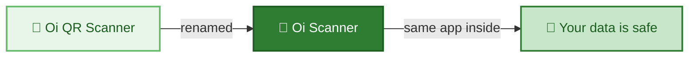

<!-- ═══════════════ HERO HEADER ═══════════════ -->

<!-- ═══════════════ APP ICON ═══════════════ -->

  

<!-- ═══════════════ TYPING ANIMATION ═══════════════ -->

 

<!-- ═══════════════ BADGES ═══════════════ -->

  
  
  
  

<!-- ═══════════════ PLAY STORE BUTTON ═══════════════ -->

  

<!-- ═══════════════ QUICK NAV ═══════════════ -->

 

## ✨ What's New

<table align="center">
  <tr>
    <td align="center" width="50%">
      <h3>🏷️ New Name</h3>
      <b>Oi QR Scanner</b> → <b>Oi Scanner</b> 
      A name that fits where the app is heading.
    </td>
    <td align="center" width="50%">
      <h3>🔒 Closed Source</h3>
      Current and future versions are no longer open source.
    </td>
  </tr>
</table>

> [!IMPORTANT]
> **Two important updates:** the app has a **new name**, and the project is now **closed source**. Details below. 👇

## 📱 App Preview

<table>
  <tr>
    <td align="center">
       
      <b>🔍 Scan</b>
    </td>
    <td align="center">
       
      <b>📜 History</b>
    </td>
  </tr>
  <tr>
    <td align="center">
       
      <b>⚙️ Settings</b>
    </td>
    <td align="center">
       
      <b>🌙 Themes</b>
    </td>
  </tr>
</table>

 

## ⚡ Highlights

<table>
  <tr>
    <td align="center" width="25%">
        
      <b>Fast</b> 
      Instant scanning
    </td>
    <td align="center" width="25%">
        
      <b>Private</b> 
      Your data stays with you
    </td>
    <td align="center" width="25%">
        
      <b>Lightweight</b> 
      Small app size
    </td>
    <td align="center" width="25%">
        
      <b>Accurate</b> 
      Reliable detection
    </td>
  </tr>
</table>

## 💬 Message from the Developer

> ### *"Every project evolves. Here are two important updates I want to share with you."*
> — **Shuvo**, Developer of Oi Scanner

 

### 🔄 A New Name

&nbsp;

&nbsp;

 

**Oi QR Scanner** is now **Oi Scanner**.

For a number of reasons, I decided to give the app a new name that better represents its future direction. This is **only a name change** — the app you know is still the same underneath.

> [!NOTE]
> - ✅ Your data and settings are untouched
> - ✅ All features work exactly as before
> - ✅ No reinstall or re-download required

 

### 🔒 A Change in Licensing

**Oi Scanner is no longer open source.**

After careful consideration, I have moved the project from open source to **closed source**. The source code is no longer publicly available, and I am no longer accepting contributions, forks, or pull requests.

> [!WARNING]
> This applies to **current and future versions** only.

I sincerely thank everyone who supported, tested, and contributed to the project during its open-source journey. This decision was not made lightly. 💚

## ❓ What This Means for You

<table>
  <tr>
    <td align="center" width="33%">
      <h3>🟢 Existing Users</h3>
      Continue using the app exactly as before. <b>Nothing breaks.</b>
    </td>
    <td align="center" width="33%">
      <h3>🟡 Future Versions</h3>
      Will <b>no longer</b> be open source.
    </td>
    <td align="center" width="33%">
      <h3>🔵 Previously Published Code</h3>
      Remains available under the terms of the <b>MIT License</b> it was released with.
    </td>
  </tr>
</table>

## 📌 FAQ

<b>❔ Do I need to reinstall the app?</b>

 

No. Just keep using it — updates arrive through Google Play as usual.

<b>❔ Will my data be lost?</b>

 

No. Your data and settings remain exactly as they were.

<b>❔ Can I still use the old open-source code?</b>

 

Yes. Code released before this change stays available under the <b>MIT License</b>.

<b>❔ Can I contribute or open pull requests?</b>

 

Contributions, forks and pull requests are no longer accepted for current and future versions.

 

## 💚 Get Oi Scanner

  

  

 

**Oi Scanner** (formerly *Oi QR Scanner*)

Copyright © 2026 Shuvo. All rights reserved.

